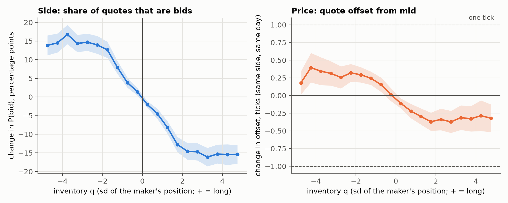
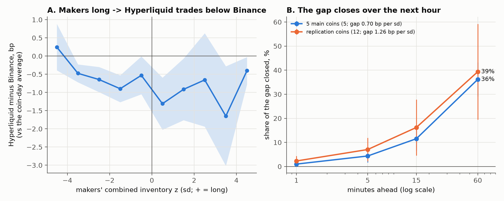

# Side, Not Price

**How on-chain market makers manage inventory, and what it does to prices.**
Pre-registered evidence from Hyperliquid. Kethan S E, November 2026.

Paper: *Side, Not Price: How On-Chain Market Makers Manage Inventory, and What It Does to Prices* ([SSRN 7713678](https://papers.ssrn.com/sol3/papers.cfm?abstract_id=7713678)).

---

## The question

Standard market-making models (Avellaneda–Stoikov, Guéant–Lehalle–Fernandez-Tapia) say a maker manages inventory by
shifting **both quote prices** against its position. Hyperliquid is a fully transparent on-chain exchange: every order
carries its account, so every quote can be matched to the inventory behind it. This repository tests the models on
**230 maker accounts, 165 million quotes, 5 coins, 86 days**, and replicates on **644 accounts in 16 more coins**.

Every confirmatory test was written down and frozen under a git tag **before** it was run. One later check (resting quotes) was not, and is labelled that way.

## Main results

| Finding | Estimate (per 1 sd of inventory) | |
|---|---|---|
| Makers pull the side that would add inventory | P(bid) −6.2 pp [−6.8, −5.7] | 16 of 16 replication coins |
| Resting quotes tilt the same way (not pre-registered) | resting bid share −7.6 pp [−8.0, −7.2]; 68% → 30% from most short to most long | all 5 coins |
| Prices barely move | −0.24 ticks [−0.28, −0.20] | far below the pre-set one-tick threshold |
| Price shading **weakens** with volatility (model says the opposite) | +0.054 ticks, p < 0.001 | |
| Side responds already at small inventory (model says only near a limit) | slope −0.096 for \|q\| < 1 | |
| Makers using side more unwind faster | Spearman +0.48, 202 makers | |
| A 10× tick jump does not change the side response | τ = +0.004, randomization p = 0.42 | natural experiment |
| The small price response is defensive | accumulating side moves 2× more than the unwinding side | |
| Makers long → Hyperliquid trades below Binance | −0.70 bp [−0.81, −0.59] | −1.26 bp on 12 more coins |
| …and the gap closes | 36% within 60 minutes | 39% on 12 more coins |

**Rejected explanations** (pre-registered, reported as nulls): coarse ticks, queue priority, reaction to toxic fills.

## Pre-registrations

| Tag | Question | Outcome |
|---|---|---|
| `prereg-v1` | Does a 10× tick change the side response? | Null |
| `prereg-v2` | Is the boundary price effect a round-number effect? | Inconclusive |
| `prereg-v3` | Do makers manage inventory as the standard model says? (T1–T4) | T1, T4 supported |
| `prereg-v4` | Tick size and the choice of tool | **Withdrawn before any run** |
| `prereg-v5` | Queue priority vs model symmetry | Not supported |
| `prereg-v6` | Stronger response after toxic fills? | Not supported |
| `prereg-v7` | Does makers' inventory move the price? | Supported |

Documents are in `docs/`. File hashes of the frozen state: `docs/FREEZE_HASHES.txt` (`python freeze.py --verify`).

## Repository layout

| Scripts | What they do |
|---|---|
| `day3`–`day12` | Data checks, order-book rebuild, inventory, quote tables, episodes, hedger/native labels, power and balance checks |
| `day13`–`day15` | Tick natural experiment: main test, secondary outcomes, placebos |
| `day16`–`day19` | Second data delivery: build, round-number test and replication |
| `day20`–`day23` | Inventory tests T1–T4, robustness, figures 1–5 |
| `day24`–`day26` | Asymmetry, toxicity and price-pressure tests (`v5`–`v7`) |
| `day27`, `day28` | Price-pressure figure; check of every number in the paper against the result files |
| `day29`, `day29b` | Resting quotes: rebuild of resting orders every 10 s, and checks on the rebuild |

Scripts that take a coin list (`day21`, `day24`–`day26`) write replication results to separate `*_replication` files,
so the frozen results are never overwritten.

## Reproducing

1. Obtain the order-level data from [0xArchive](https://0xarchive.io) (licensed; not redistributable) and Binance
   1-second prices (public).
2. Run the scripts in the order above (`python dayNN_name.py`). Data paths are set at the top of each script.
3. `python day28_verify_paper.py` compares the paper's numbers with the result files.

## Data and privacy

Raw data and any file with full wallet addresses (`*.parquet`, `*.csv` under `data/`) are not in this repository.
Outputs print at most 8 characters of an address, and firms are anonymous.

## Citation

Kethan S E (2026). *Side, Not Price: How On-Chain Market Makers Manage Inventory, and What It Does to Prices.*
SSRN working paper 7713678. ORCID 0009-0007-9020-7273.
